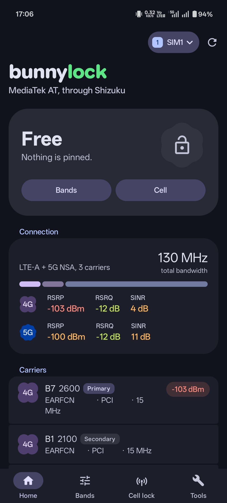
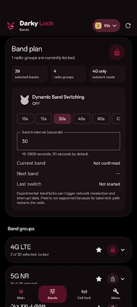
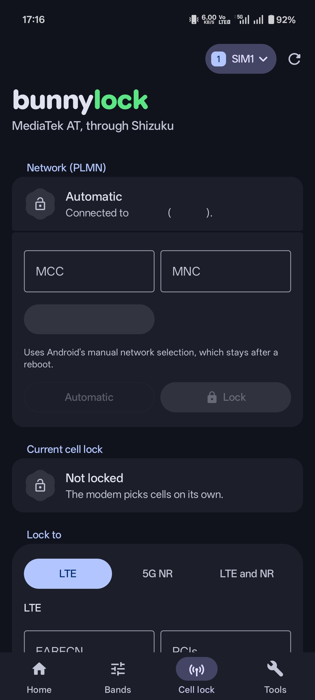
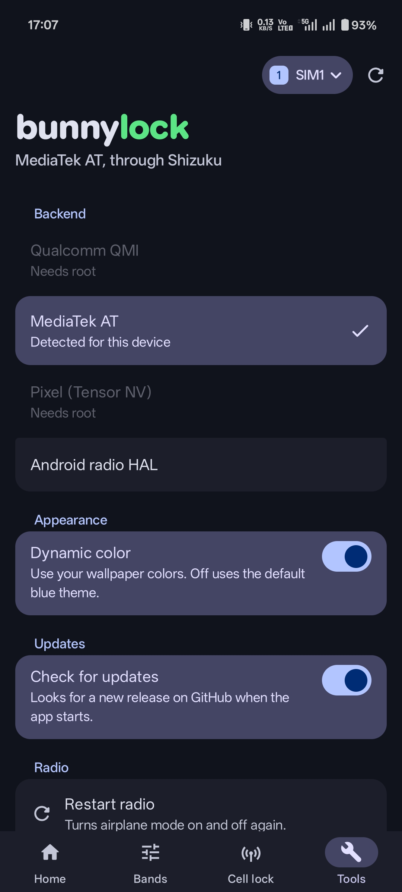

<p align="center">
  
</p>

bunnylock is an Android app for band, RAT, and cell locking. It talks to the modem through root or Shizuku and picks the best backend available on the phone.

Modems are weird, and vendors rarely implement the same controls in the same way. Something working on one phone does not guarantee that it will work on every phone with the same chipset or Android version.

<table>
  <tr>
    <td align="center"></td>
    <td align="center"></td>
    <td align="center"></td>
    <td align="center"></td>
  </tr>
  <tr>
    <td align="center">Home</td>
    <td align="center">Bands</td>
    <td align="center">Cell lock</td>
    <td align="center">Tools</td>
  </tr>
</table>

> [!CAUTION]
> bunnylock changes low-level modem settings. Some of them stay after a reboot, and modems don't always react the way you'd expect. **You use it at your own risk.**
>
> The author isn't responsible for any issues or damage it causes. That includes losing service or messages (emergency calls too), lost data, or a phone that stops working properly. Before you experiment, make sure you know how to undo a change: **Unlock all**, or a network settings reset in your phone's settings.
>
> bunnylock is provided "as is", without any warranty. See the [license](LICENSE) for the full terms.

## Features

Depending on the phone and backend, bunnylock can:

- lock 2G, 3G, 4G, and 5G bands
- force a RAT, such as 4G only or 5G only
- lock LTE and NR frequencies using EARFCN or ARFCN
- lock one or more PCIs on supported modems
- select 5G SA, NSA, or both
- lock to a mobile network (PLMN)
- monitor the active data SIM's Home PLMN with **Dynamic PLMN Lock**, using a foreground service and persistent notification
- re-attach, restart the radio, or reboot the modem
- clear active locks with **Unlock all**
- save local band and cell-lock profiles for quick reuse
- use a silent active-lock notification and separate Quick Settings tiles for toggling locks, restarting the radio, and rebooting the modem
- choose Arabic, Polish, Simplified Chinese, English, or the system language

See [Tested devices](TESTED_DEVICES.md) for combinations that have been tried on real phones.

## Access

bunnylock needs either root or [Shizuku](https://shizuku.rikka.app/). It tries root first and falls back to Shizuku when root is unavailable or denied.

- **Root or Shizuku running as root** gives bunnylock full access to the available modem backend.
- **Shizuku started through ADB** can use Android's telephony APIs without root.
- Some **MediaTek** phones expose an AT-command passthrough through Shizuku, allowing real band and cell locking without root.

## Backends

bunnylock detects the phone automatically. You can override the backend in **Tools** if the automatic choice is wrong.

- **Qualcomm** - talks to the modem over QMI.
- **MediaTek** - uses the same AT commands as MediaTek EngineerMode.
- **Pixel Tensor** - uses Shannon modem settings exposed by Pixel firmware.
- **Samsung Exynos and other devices** - uses Android's radio HAL. On supported Samsung phones, bunnylock can also open the built-in Samsung band menu.

Available features still depend on what the modem and firmware accept. In particular, Android's radio HAL controls are vendor-dependent.

## Using it

1. Grant root access, or start Shizuku and allow bunnylock to use it.
2. Pick the SIM you want to control.
3. Use **Bands** to select bands, or **Cell lock** to enter an EARFCN, ARFCN, or PCI.
4. To save a setup, select preferred bands and enter any cell-lock values, open **Profiles**, choose **Save current setup**, and give it a name. Tap a saved profile to apply it; applying restores all saved band groups and clears an existing cell lock when the profile has no cell values.
5. Add the **Toggle bunnylock**, **Restart radio**, and **Reboot modem** tiles from the Quick Settings tile editor. Android gives each tile one tap action, so these are separate tiles. The toggle tile unlocks active locks, or applies the first saved profile when no lock is active.
6. Use **Unlock all** on the Home screen to return to the default configuration.

Locking a band or cell that your carrier does not use can leave the phone without service. **Unlock all** works offline, so keep it in mind while experimenting.
The low-importance notification appears while locks are active and includes the same quick actions. Android requires notification permission on Android 13 and later.

Dynamic PLMN Lock is enabled from the PLMN section on the Cell screen. It checks on a 60-second target interval, reports the modem's PLMN-lock state when that state is readable, and only requests the Home PLMN lock when the modem confirms no other PLMN lock is active. The ongoing foreground-service notification remains while monitoring is enabled. Android Doze, vendor battery policies, permission changes, or system service restrictions can delay or stop checks; the app reports when its service is not running rather than guaranteeing a schedule. If enabled before a reboot, bunnylock attempts to restore monitoring after boot, subject to Android's background-start rules and available Root/Shizuku access. Stopping Dynamic leaves any existing PLMN lock in place.

If something fails, copy the diagnostics from **Tools**. They include the detected chipset, backend, available interfaces, and recent operation log.

## Building

You need:

- JDK 17 or newer
- Android SDK
- Android NDK `29.0.14206865`
- CMake `3.22.1`

On Windows:

```powershell
.\gradlew.bat assembleRelease
```

On Linux or macOS:

```sh
./gradlew assembleRelease
```

The APK is written to `app/build/outputs/apk/release/app-release.apk`

### Signing

By default, release builds are signed with your machine's debug key. To use your own key, create `keystore.properties` in the project root.

```properties
storeFile=C:/keys/release.jks
storePassword=...
keyAlias=...
keyPassword=...
lineageFile=C:/keys/lineage.bin
```

`lineageFile` is optional. It points to a lineage made with `apksigner rotate`, which lets builds signed with the new key update installs signed with an older one.
